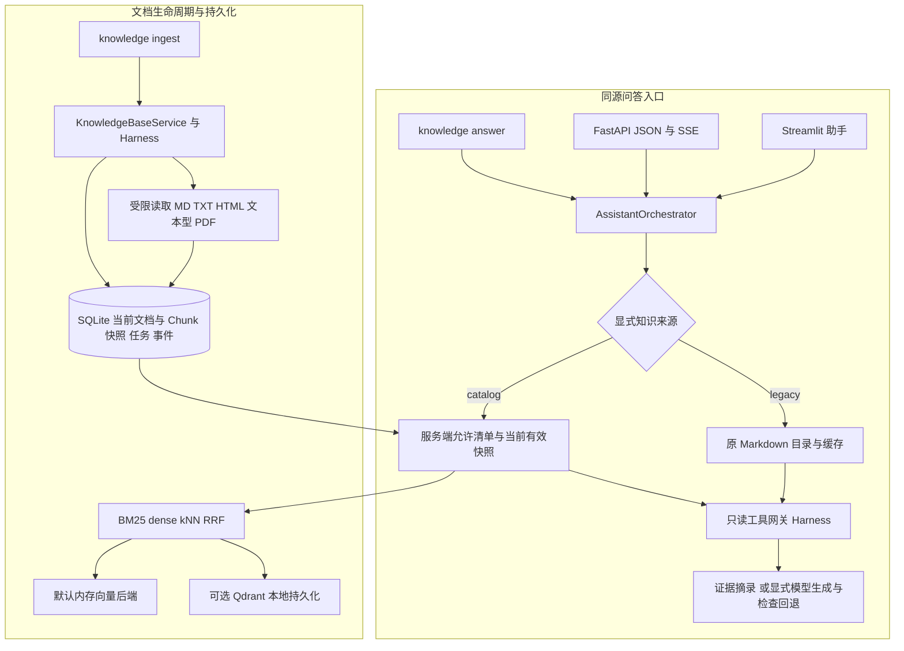
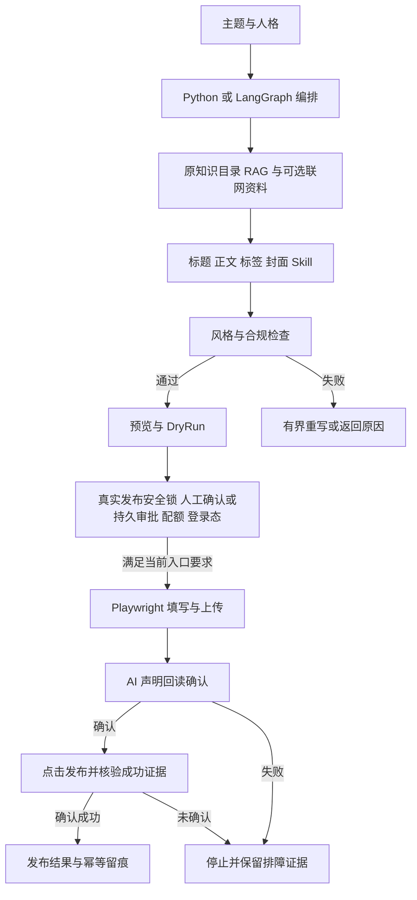
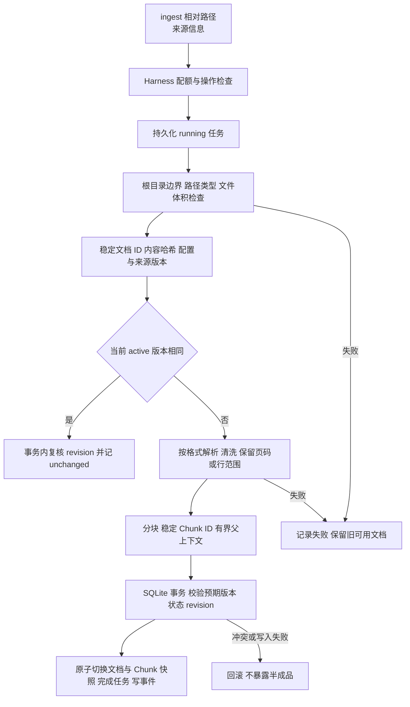
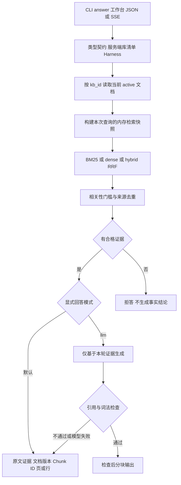
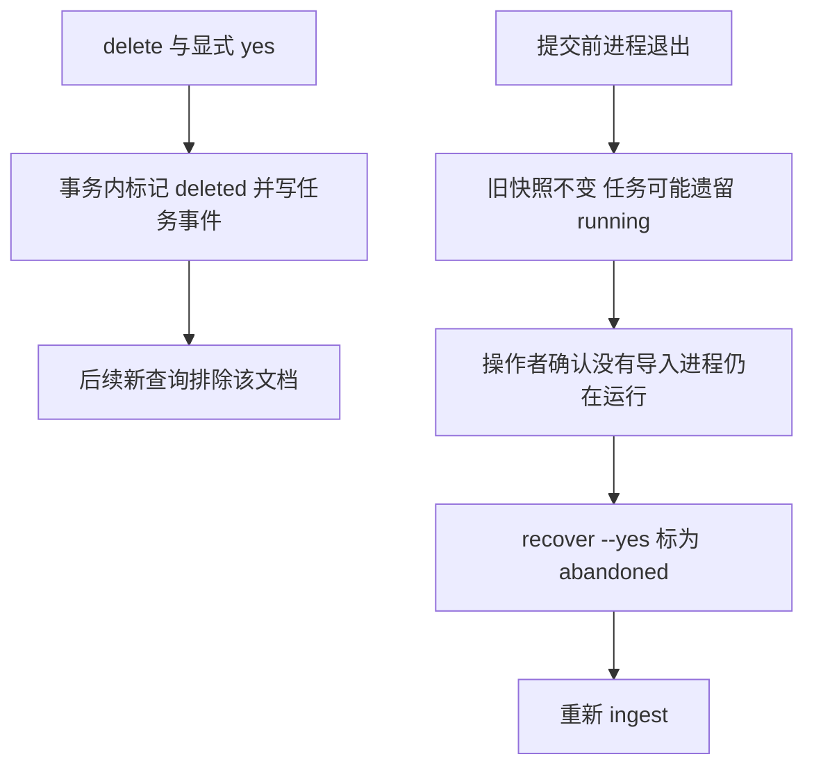
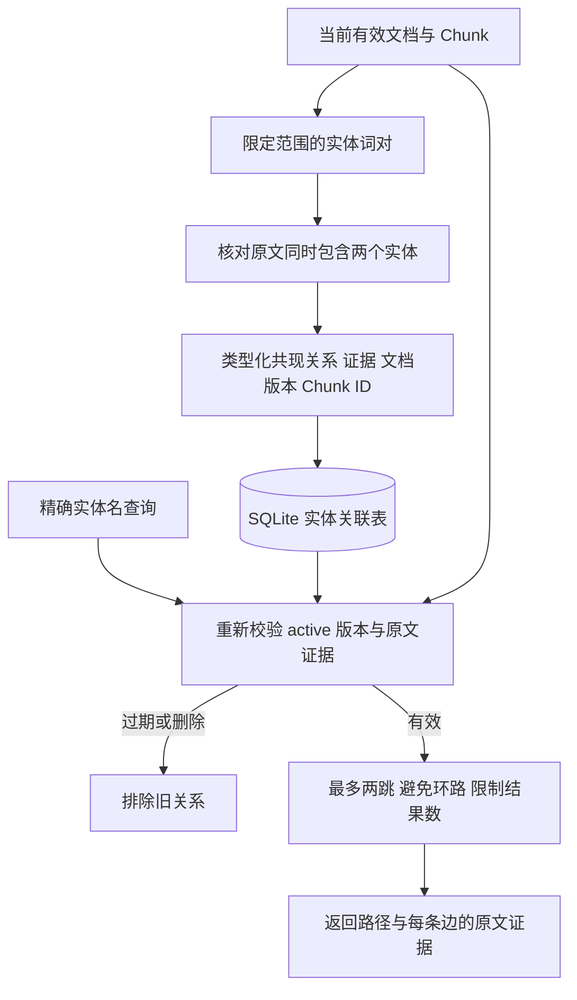

# PersonaX 项目架构与流程图

文档更新：2026-10-22。图示主要描述目录库、内容发布和实体关联；受控检索 Agent 的决策循环见 [协议说明](RETRIEVAL_AGENT.md)。发布基线仍为 `2.8.1`。

本文保留旧文件名，方便以前的链接继续使用。主体展示软件架构与数据流；第六图另展示已经实现的原文实体共现图。Qdrant 本地适配与实体关联已实现，不等于 Qdrant Server、Neo4j、因果知识图谱或完整 GraphRAG。

图像与源文件见 [六张流程图](diagrams/README.md)，不再维护重复的 Word 导出。

## 一 总体架构

内容生成仍读取 `knowledge/*.md`；助手现在可以选择 legacy 原目录或 catalog 版本化目录库。CLI answer、FastAPI 与工作台复用同一个助手编排和有效快照，而不是各自实现一套问答。

FastAPI 不暴露发布或文件上传/删除路由；已提供目录库问答和只读实体关联查询。入库与删除继续由本地 CLI 明确执行。Docker 验收仍为历史记录，本阶段未重建镜像。

## 二 内容生成与发布流程

这是逻辑流程，不表示审批策略在所有旧 CLI / 定时入口都已统一。持久审批的 interrupt/resume、草稿指纹和 consumed 状态已有实现；全入口强制同一策略仍需继续收口。平台成功案例是历史证据，本轮没有重新登录或发布。

## 三 文档入库与更新流程

文档 ID 取决于 `kb_id + 相对路径`；版本还包含内容 SHA-256、解析/分块配置与来源信息。不能只凭文件名、大小或 mtime 判断是否变化。文件重命名会形成新身份，原记录需要显式删除。

事务解决“文档已更新但任务或事件没写完”的半成品问题；单调递增 revision 解决过期写入覆盖删除/重新导入的问题。数据库保存当前快照，不提供完整历史版本回放。

## 四 目录库检索与来源返回

默认 `hashing + hybrid` 用于离线工程验证，并有仅适用于 hashing 的词面依据检查；hashing 不是语义模型。`knowledge search` 返回证据；Workflow 的 `knowledge answer` 默认摘录，显式 `--answer-mode llm` 才调用回答模型。目录库 SSE 为检查后分块输出；词法检查不证明语义事实正确。真实模型运行与回退结果见 [验证记录](TEST_RESULTS.md)。

每次查询重建当前快照，因此删除/更新提交后，新查询不会继续读到旧有效记录；已开始的查询不追溯撤销。可选 Qdrant 本地后端用有效 point ID 和库标识过滤，但仍逐快照 upsert，旧点尚未物理回收；不是增量同步最优解、服务端 ANN 或分布式事务。

## 五 删除与中断处理

软删除不会删除源文件，也不代表 SQLite 历史字节安全擦除。`recover` 是人工确认后的遗留任务核查，不是断点自动续跑；不能在另一个导入仍运行时执行。

## 六 模块与实现取舍

| 模块 | 当前职责 | 优点 | 代价或边界 |
|---|---|---|---|
| `core/knowledge.py` | 类型化入库、删除、证据检索编排 | 生命周期集中，复用 Harness / RAG | 本地单操作者，无远程接入 |
| `core/document_parser.py` | 路径约束、格式提取、清洗、页/行定位 | 来源可追溯，失败明确 | 不做 OCR、复杂表格恢复或进程级沙箱 |
| `core/knowledge_store.py` | 当前快照、任务、事务事件、revision 冲突检测 | 部署简单，失败不污染旧数据 | 非完整历史归档或分布式任务队列 |
| `core/rag.py` | BM25、dense 精确 kNN、RRF、可选增强 | 保留 VectorStore 与旧目录入口 | 查询建索引成本；大规模收益未验证 |
| `core/assistant_tools.py` | 类型化来源与安全 URL、证据摘录 | 原助手与目录库共用来源契约 | MCP-ready Schema 不等于已实现 MCP Server |
| `core/knowledge_graph.py` | 原文实体关联、两跳路径、版本失效检查 | 每条关系有可核对来源 | 只表示共现，不自动推断专业语义或因果 |
| `core/qdrant_store.py` | 可选本地持久化与快照过滤 | 保留原 VectorStore 接口 | 未做 Qdrant Server/ANN 或旧点物理回收 |

输入上限为单文件 5 MiB、提取文本 500,000 字符、PDF 100 页、每文档 2,000 Chunk。文本仅接受 UTF-8（允许 BOM）；扫描/空白 PDF 失败关闭；`kb_id` 是数据分区，不是身份认证或 RBAC。

## 七 验证范围

固定工程集和合成文档只验证目录行为；实体共现不表达因果。当前结果、真实模型失败与容器待验收范围集中在 [验证记录](TEST_RESULTS.md)，导入、删除和恢复见 [目录库](KNOWLEDGE_BASE.md)。

## 八 实体关联与来源失效

关系类型明确为 `co_mentions`，是可验证的实体共现图，不表达因果。HTTP 与工作台只能只读查询，实体和关系不由模型自由生成后直接执行。
